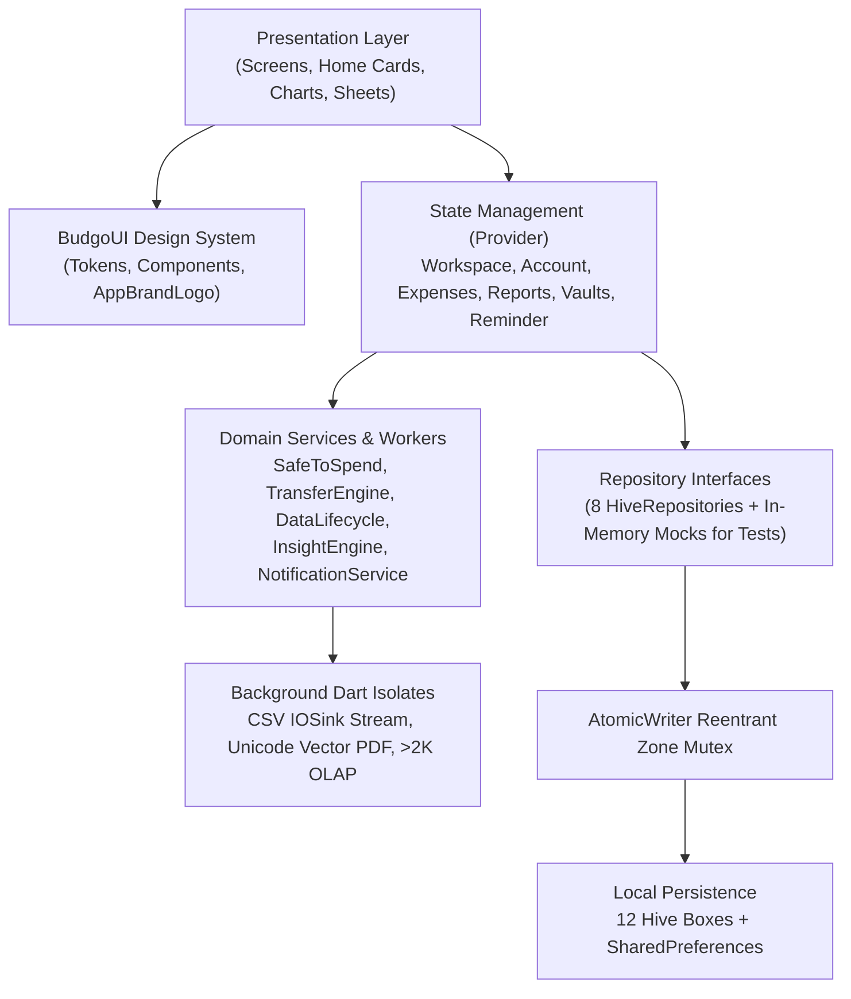
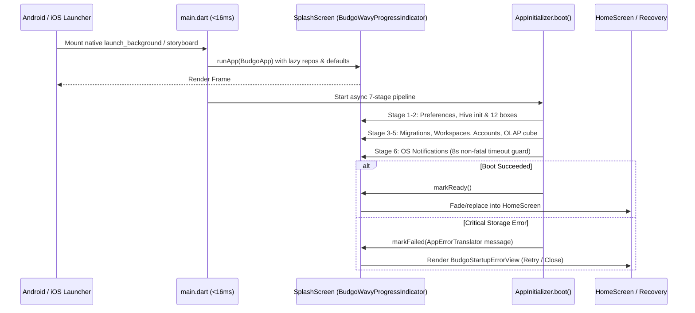

<div align="center">
  

  <h1>Budgo &mdash; Offline-First Personal Finance &amp; Multi-Workspace Ledger</h1>

  <p>
    <strong>Track expenses, isolate workspaces, guard your daily burn rate, and export publication-grade financial statements &mdash; 100% offline with zero servers, zero trackers, and 60/120&nbsp;FPS speed.</strong>
  </p>

  <p>
    
    
    
    
    
  </p>

  <p>
    <em>Notice: The current working title <strong>Budgo</strong> is governed from a single centralized manifest (<a href="tool/brand_manifest.json"><code>tool/brand_manifest.json</code></a>) ahead of final trademark branding. Latest release binaries and tags are published directly in <a href="https://github.com/2005-rafi/expense-tracker-flutter/releases">GitHub Releases</a> (see <a href="CHANGELOG.md"><code>CHANGELOG.md</code></a>).</em>
  </p>
</div>

---

## Table of Contents
- [1. The Story: Why This App Exists (Meet Aarav)](#1-the-story-why-this-app-exists-meet-aarav)
- [2. Feature Ecosystem & User Experience](#2-feature-ecosystem--user-experience)
- [3. Screenshots](#3-screenshots)
- [4. Tech Stack & Dependencies](#4-tech-stack--dependencies)
- [5. Software Engineering Principles & Security](#5-software-engineering-principles--security)
- [6. System Design, Architecture & Diagrams](#6-system-design-architecture--diagrams)
- [7. Modules & Project Structure](#7-modules--project-structure)
- [8. Centralized Branding & Anti-Tamper Workflow](#8-centralized-branding--anti-tamper-workflow)
- [9. Releases, Setup & How to Run](#9-releases-setup--how-to-run)
- [10. Development & Testing Verification](#10-development--testing-verification)
- [11. Known Gaps & Future Implementation Roadmap](#11-known-gaps--future-implementation-roadmap)
- [12. Copyright, License & Legal Notice](#12-copyright-license--legal-notice)

---

## 1. The Story: Why This App Exists (Meet Aarav)

Meet **Aarav**, a 26-year-old salaried software consultant living in Bengaluru who handles three very different financial lives every month:

1. His **Personal** household ledger in **INR (`₹`)** — rent, groceries, metro commutes via UPI, cash wallet spending, and an emergency medical envelope.
2. His weekend **Freelance** client profile in **USD (`$`)** — software retainers and server domain bills that must **never** leak into his personal food-budget math or tax statements.
3. A shared **ManaliTrip** travel wallet funded at the start of the month, where any unspent cash gets swept neatly back to his bank when he lands home.

Aarav tried conventional finance apps and hit four recurring walls:
- **Cloud bloat & privacy distrust:** Every keystroke synced to remote servers, loaded sluggish ads, or hung on underground train commutes with flaky 4G.
- **Mixed Ledgers & Ghost Balances:** Logging a client domain charge polluted his personal monthly spend; moving money from Bank to Cash Wallet falsely counted as "income" or double-counted net worth.
- **The "Zero-Expense Blindspot":** Halfway through the month, seeing *"Spent ₹14,200"* didn't answer the only question he cared about before buying dinner: *"How much can I safely spend **today** without missing my rent EMI?"*
- **Toy Exports & Late Bill Notifications:** Exporting 3+ years of history froze the UI or mangled `₹` symbols in PDFs; battery-heavy background services killed recurring bill alerts.

**This app was engineered to solve every one of Aarav's problems on-device** — combining strict relational workspace isolation, integer minor-unit accounting, math-backed daily burn guidance, native OS RTC notification channels, and multi-isolate streaming exports without sending a single byte over the network.

---

## 2. Feature Ecosystem & User Experience

### Strict Multi-Workspace Profiles (`Personal`, `Business`, `Trip`, `Project`, `Savings Pool`)
- **Zero-Leak Isolation:** Expenses, Incomes, Accounts, Transfers, Savings Vaults, Planned Wishlists, Reports OLAP partitions, Bill Reminders, and Data Deletion operate strictly inside the active workspace scope.
- **Per-Workspace Currency & Naming Safety:** Workspace creation enforces a grapheme-safe **20-character limit with zero spaces** (`BudgoInputPolicy.workspaceName`) across UI and domain layers so compact pills, notification titles, and filenames never wrap awkwardly.
- **Fund-Sweep Deletion Gate:** Prevents accidentally deleting a secondary workspace containing unspent funds (`ValidationException`), prompting a pre-deletion cross-workspace sweep directly into a target account.

### Accounts, Signed Net Equity & Atomic Self-Transfers
- **Four Custody Types:** `Cash`, `Bank Account`, `UPI`, and `Credit Card`.
- **Universal Signed Net Equity:** Liquid accounts store positive integer paise/cents (`balancePaise >= 0`); Credit Cards track debt naturally as non-positive balances (`<= 0`), eliminating branching math errors in net-worth totals.
- **Self-Transfers & Crash-Safe Rollbacks:** Every account-to-account or workspace-to-workspace transfer executes under [`AtomicWriter`](lib/core/storage/atomic_writer.dart) and logs into an immutable `TransferJournalEntry` box for clean reversals.

### Financial Intelligence & Safe-to-Spend Engine
- **Safe-to-Spend (`STS`) Daily Burn Rate:** Divides free unallocated funds (capped by true liquid assets and upcoming unpaid bills) across the remaining days of the cycle (`>= 1`). Tapping the Safe-to-Spend badge on the Home Card opens an **Interactive Derivation Sheet** displaying the exact step-by-step arithmetic in plain language.
- **Dedicated Savings Vaults:** Earmark money inside custodial accounts toward locked or flexible goals without inventing fake accounts.
- **Pay-Yourself-First (`PYF`) Prompt & Draft Incomes:** Expected salaries start as drafts; swiping/confirming triggers an inline reserve nudge into your priority savings vault.
- **Credit Card Settlement Triage:** Due banners on Home let users settle Total Due, Available Liquid Balance, or Custom Amounts in 1 tap.

### Battery-Friendly OS Reminders (Per-Workspace Channels)
- Uses OS-level `AlarmManager` / `UNUserNotificationCenter` schedules (`flutter_local_notifications` + `timezone`) rather than background Dart isolate timers, preserving battery on low-end to flagship hardware.
- **Clean Tray Ergonomics:** Each workspace registers an isolated Android channel (`budgo_ws_<id>_v1`) and iOS thread group (`groupKey` / `threadIdentifier`), styled with logo iconography and collapsed vs expandable *"Read more"* details containing three minimal quick actions: **Done**, **Skip**, and **Cancel**.

### Reports OLAP Engine & Publication-Grade Export (CSV & PDF)
- **Sub-Millisecond Analytical Deck:** Pre-partitioned workspace cubes (`WorkspaceReportPartition`) deliver $O(1)$ workspace switching, binary-search date slicing, $O(N \log K)$ Top-K Min-Heap category extraction, calendar spending heatmaps, line trends, pie charts, and payment-method (`UPI`/`Cash`/`Bank`) filtering across **24,000+ records**.
- **Scope-Selectable Exports:** Export **Single Workspace**, **Selective Checkboxes**, or **Combined All Workspaces**, with optional **expenses, incomes, transfers, archived records, and trend charts**.
- **CSV Engine:** Streaming `IOSink` writer inside a background `Isolate` (`O(chunkSize)` RAM), **UTF-8 BOM (`EF BB BF`)** so Excel renders `₹ / € / £` natively, formula-injection cell sanitization (`=`, `+`, `-`, `@`), workspace reconciliation tables, and daily trend rows.
- **PDF Engine:** Bundles offline `Roboto` TTF weights for full Unicode currency support (`₹`, `€`, `£`, `¥`, `$`), top-center brand masthead + resized `app_logo_pdf.png`, vector `pw.Chart` cumulative line visualization with legend, chronological ledger pagination (`28 rows/page`, $O(N)$ linear layout eliminating `MultiPage` table bottlenecks), and capped-detail safety (`4,000` rows max in PDF).

---

## 3. Screenshots

> Designed with a unified **Material 3 Expressive** token system, adaptive light/dark contrast modes, top-layer root `Overlay` toast notifications (`BudgoToastBanner`), and zero-black-screen wavy splash boot.

<table>
  <tr>
    <td align="center"><br/><sub><strong>Home Dashboard</strong></sub></td>
    <td align="center"><br/><sub><strong>Activity &amp; Search</strong></sub></td>
    <td align="center"><br/><sub><strong>Settings &amp; Lifecycle</strong></sub></td>
  </tr>
  <tr>
    <td align="center"><br/><sub><strong>Category Breakdown</strong></sub></td>
    <td align="center"><br/><sub><strong>Trend Analytics</strong></sub></td>
    <td align="center"><br/><sub><strong>Spending Heatmap</strong></sub></td>
  </tr>
</table>

---

## 4. Tech Stack & Dependencies

Verified directly from [`pubspec.yaml`](pubspec.yaml):

| Layer | Technology / Package | Version Constraint | Role in System |
|---|---|---|---|
| **Framework & Runtime** | Flutter SDK / Dart | Dart `^3.8.1` | Material 3 UI, multi-isolate execution, custom canvas painters |
| **State Management** | `provider` | `^6.1.5` | `ChangeNotifier` & `ProxyProvider` dependency graph |
| **Primary Persistence** | `hive` + `path_provider` | `^2.2.3` / `^2.1.5` | Binary box Key-Value store (`TypeId` adapters `0..5, 7..15`) |
| **Settings Persistence** | `shared_preferences` | `^2.5.3` | Atomic/self-healing primitive UI preferences via `SafePreferences` |
| **Charts & Visualization** | `fl_chart` | `^1.0.0` | Interactive Pie, Bar, and Line spending charts |
| **Export Engines** | `pdf`, `csv`, `share_plus` | `^3.11.0` / `^6.0.0` / `^11.0.0` | Background-isolate PDF vector charts, streaming CSV, OS share bridge |
| **OS Notifications** | `flutter_local_notifications`, `timezone`, `flutter_timezone` | `^18.0.0` / `^0.9.4` / `^5.0.2` | Native Android channels & iOS actionable notification schedules |
| **Typography & Docs** | Bundled `Roboto` family, `google_fonts`, `flutter_markdown`, `intl` | `^6.2.1` / `^0.7.7+1` / `^0.20.2` | Offline TTF rendering (`allowRuntimeFetching = false`), policy reader |
| **Codegen & Tooling** | `hive_generator`, `build_runner`, `flutter_launcher_icons`, `flutter_lints` | Dev dependencies | Hive TypeAdapter generation & strict static analysis |

---

## 5. Software Engineering Principles & Security

Every module in this codebase is structured around core engineering invariants:

1. **SOLID & Centralized UI Governance:**
   All interactive components live behind [`lib/design/budgo_ui.dart`](lib/design/budgo_ui.dart) (`BudgoAppBar`, `BudgoBottomSheet`, `BudgoButton`, `BudgoTextField`, `BudgoAmountField`, `BudgoDropdownField`, `BudgoActionDialog`, `BudgoLayeredActionLayout`, `AppBrandLogo`, `BudgoWavyProgressIndicator`, `BudgoToastBanner`). Repository abstractions (`AccountRepository`, `ExpenseRepository`, etc.) decouple state providers from physical storage.
2. **ACID-Inspired Atomic Writes & Exact Integer Math (DBMS):**
   - Monetary amounts are stored strictly as minor-unit **64-bit integers (`paise` / `cents`)**, eliminating IEEE-754 floating-point rounding drift.
   - Multi-step mutations (transfers, vault deposits, credit settlements, reset wipes) run sequentially inside [`AtomicWriter`](lib/core/storage/atomic_writer.dart), backed by `JobRecord` & `TransferJournalEntry` write-ahead recovery markers checked by `JobReconciler` during startup.
   - Batch cleanup chunks deletions (`500` records per slice) and records crash-recovery descriptors in `AppStateBox` so interrupted wipes resume idempotently.
3. **Zero-Black-Screen Resilient Boot & Fault Tolerance:**
   - Native Android (`launch_background.xml` light/night themes) and iOS (`LaunchScreen.storyboard`) match the Flutter splash theme (`#FFF8F2` / `#17130B`).
   - `main()` mounts Frame #1 cleanly in `<16ms` via [`SplashScreen`](lib/screens/splash_screen.dart), while [`AppInitializer.boot()`](lib/core/initialization/app_initializer.dart) runs 7 staged initialization phases asynchronously with lazy box resolution. Platform notification failures degrade non-fatally; critical storage failures render [`BudgoStartupErrorView`](lib/design/components/budgo_startup_error_view.dart) instead of black screens or infinite spinners.
4. **Data Structures & Performance (DSA):**
   - **Sliding Activity Viewport:** `ActivityProvider` + `ExpensesProvider` paginate large ledgers incrementally instead of inflating thousands of offscreen list widgets.
   - **In-Memory Prefix Index:** Enables instantaneous search across transaction histories.
   - **Partitioned OLAP Cube:** Pre-aggregates daily, weekly, monthly, and yearly heatmaps in $O(1)$ per incremental write and $O(1)$ per workspace swap.
5. **CIA Triad & Attribution Integrity:**
   - **Confidentiality:** Strictly 0 network APIs, `android:allowBackup="false"`, and CSV formula-injection neutralization (`sanitizeCsvCell`).
   - **Integrity:** [`BrandIntegrity`](lib/core/security/brand_integrity.dart) stores developer attribution, support email, copyright, and legal texts as stride-permuted rotating XOR byte arrays sealed by a pure-Dart **FIPS 180-4 SHA-256** digest (`AppBrand.verifyIntegrity()`). Any binary hex-patching mismatch triggers a visible **Build Integrity Notice** on [`AboutScreen`](lib/screens/about_screen.dart) and refuses to display spoofed developer/copyright attribution.
   - **Dynamic Error UX:** [`AppErrorTranslator`](lib/core/errors/app_error_translator.dart) intercepts domain/storage/platform exceptions, strips internal stack/ID clutter, and renders root-overlay guidance banners with actionable steps.

---

## 6. System Design, Architecture & Diagrams

### Layered Application Architecture



### Zero-Black-Screen Cold Startup Sequence



### Hive Local Schema Registry (`12` Boxes)

| Box Constant | Key Model(s) | `HiveType` ID | Responsibility |
|---|---|---|---|
| `expenses` | `Expense` | `0` | Debit ledger entries linked to workspace, account & category |
| `incomes` | `Income` | `1` | Draft/confirmed income inflows |
| `future_expenses` | `FutureExpense` | `2` | Planned wishlist purchases & 1-tap conversion link |
| `budgets` | `Budget` | `3` | Per-workspace spending limit & period configuration |
| `reminders` | `Reminder` | `4` | Workspace-scoped recurring/one-time OS notification records |
| `jobs` | `JobRecord` | `5` | Persistent background reconciliation state |
| `workspaces` | `Workspace`, `WorkspaceType` | `7`, `8` | Isolated personal, business, trip, project & pool profiles |
| `accounts` | `Account`, `AccountType` | `9`, `10` | Cash, Bank, UPI & Credit Card signed balances |
| `transfers` | `Transfer`, `TransferStatus` | `11`, `12` | Cross-account & cross-workspace atomic money movements |
| `transfer_journal` | `TransferJournalEntry` (`13` / `14` records) | `13`, `14` | Debit/credit audit journal entries enabling clean reversals |
| `savings_vaults` | `SavingsVault` | `15` | Virtual reserve goals backed by custodial liquid accounts |
| `app_state` | Dynamic Box | &mdash; | Active workspace pointer, user categories, crash-recovery markers |

---

## 7. Modules & Project Structure

```text
├── android/ & ios/               # Native launch themes, notification icons & strings.xml
├── assets/
│   ├── fonts/                    # Offline Roboto Regular/Medium/Bold/Black + CondensedBold TTFs
│   ├── icon/                     # Launcher emblem (app_icon.png) & PDF badge (app_logo_pdf.png)
│   └── screenshots/              # Verified UI captures
├── lib/
│   ├── main.dart                 # Zero-blocking entry point & global ErrorWidget handler
│   ├── core/
│   │   ├── constants/            # app_brand.dart (generated), app_constants, app_input_limits, legal_policies
│   │   ├── currency/             # CurrencyFormatter & Money paise formatting
│   │   ├── errors/               # AppErrorTranslator & typed domain AppException hierarchy
│   │   ├── initialization/       # Phased AppInitializer, AppReadinessNotifier, JobReconciler
│   │   ├── registries/           # CategoryRegistry & CuratedIconsCatalog (100 offline icon pairs)
│   │   ├── security/             # BrandIntegrity (pure-Dart SHA-256 + XOR masking verification)
│   │   ├── storage/              # AtomicWriter, FinanceBoxes, AppStateBox, HiveMigration, MultiProfileMigration
│   │   └── utils/                # InputValidators & O(N log K) Top-K Min-Heap
│   ├── design/                   # Unified Material 3 Expressive Design System (budgo_ui.dart)
│   │   ├── components/           # Reusable buttons, sheets, dialogs, text fields, counters, wavy progress
│   │   ├── theme/                # M3 light/dark/high-contrast ThemeData & color extensions
│   │   └── tokens/               # Spacing, layout breakpoints, motion, radius, typography & icons
│   ├── models/                   # Immutable/Hive-annotated domain models + view_models/
│   ├── navigation/               # AppRoutes & shared-axis transitions
│   ├── providers/                # 12 ChangeNotifier state managers
│   ├── repositories/             # Lazy-safe Repository interfaces + Hive implementations
│   ├── screens/                  # Splash, AppShell, Home, Activity, Reports, Settings, About & Legal
│   ├── services/                 # Analytics cube, Export engines, SafeToSpend, VaultAllocation, Transfers, OS Notifications
│   └── widgets/
│       ├── charts/               # Heatmap, Pie, Bar, Line & chart panels
│       ├── home/                 # Budget card, Pay-Yourself-First, Credit due banner, Recent activity, Workspace pill
│       ├── sheets/               # 15 modal bottom sheets & M3 readers (Export, Legal, Data Management, Reminders, Vaults)
│       └── tiles/                # Settings tile, transaction tile, smart notification tile
├── test/                         # 29 test files covering core, design, models, providers, services & widgets
└── tool/
    ├── brand_manifest.json       # Single-source brand configuration (excluded from APK assets)
    └── sync_brand.dart           # CLI generator updating Dart brand vault, SHA-256 seal, Android & iOS labels
```

---

## 8. Centralized Branding & Anti-Tamper Workflow

Because the current working name (**Budgo**) collides with an existing third-party app name, **zero UI copy hardcodes the brand name or developer details**. All strings are generated from a single manifest outside the bundled `assets/` tree:

1. Edit [`tool/brand_manifest.json`](tool/brand_manifest.json) (`appName`, `fileSlug`, `appTagline`, `developerName`, `contactEmail`, `showSourceLinks`, etc.).
2. Sync everything in one command:
   ```bash
   fvm dart run tool/sync_brand.dart
   ```
3. This automatically regenerates [`lib/core/constants/app_brand.dart`](lib/core/constants/app_brand.dart), [`lib/core/constants/legal_policies.dart`](lib/core/constants/legal_policies.dart) (with refreshed SHA-256 digest & masked byte arrays), [`android/app/src/main/res/values/strings.xml`](android/app/src/main/res/values/strings.xml), and [`ios/Runner/Info.plist`](ios/Runner/Info.plist).

---

## 9. Releases, Setup & How to Run

### GitHub Releases (Pre-Built Binaries)
A compiled release matching **Version 3.0.0 (`Build 300`)** is published directly in the **[GitHub Releases](https://github.com/2005-rafi/expense-tracker-flutter/releases)** section of this repository (full release history in [`CHANGELOG.md`](CHANGELOG.md)).

### Prerequisites
- **Flutter SDK** compatible with Dart `^3.8.1` (managed cleanly with `fvm` if configured)
- Android Studio / Xcode toolchain for mobile device/emulator builds

### Run Locally from Source

```bash
# 1. Clone the repository
git clone https://github.com/2005-rafi/expense-tracker-flutter.git
cd expense-tracker-flutter

# 2. Fetch Flutter packages
fvm flutter pub get

# 3. Sync centralized branding & SHA-256 attribution vault (optional unless editing brand_manifest.json)
fvm dart run tool/sync_brand.dart

# 4. Run on a connected Android/iOS device or emulator
fvm flutter run
```

*(Note: If you modify Hive `@HiveType` models, regenerate `.g.dart` adapters first:)*
```bash
fvm dart run build_runner build --delete-conflicting-outputs
```

### Recommended Hardened Production Build
```bash
fvm flutter build apk --release --obfuscate --split-debug-info=build/symbols
# or Android App Bundle:
fvm flutter build appbundle --release --obfuscate --split-debug-info=build/symbols
```
> Enables R8 code shrinking (`isMinifyEnabled = true`, already configured in `build.gradle.kts`) and strips Dart class/method symbols while preserving stack trace decoding via `build/symbols`.

---

## 10. Development & Testing Verification

All code-quality gates and automated test suites are strictly maintained and executed step-by-step:

| Verification Command | Scope | Verified Result |
|---|---|---|
| `fvm flutter analyze` | Full project static lint & type safety | `0 issues found` |
| `fvm flutter test test/core test/design test/models` | Error translator, SHA-256 & byte masking integrity, categories, M3 UI tokens, models | `44/44 passed` |
| `fvm flutter test test/provider` | Activity, Categories, Reminders, Workspaces (`TEST-WS-01`, `TEST-SWEEP-01`) | `22/22 passed` |
| `fvm flutter test test/services` | `24,000`-row OLAP slicing, streaming CSV/PDF isolates, Safe-to-Spend math, Data Lifecycle wipes | `30/30 passed` |
| `fvm flutter test --concurrency=1 --timeout 30s test/widgets` | Splash boot, About & Legal sheet, layered actions, input limits, isolated reports & sheets | `31/31 passed` |

**Total Automated Coverage:** **127 / 127 tests passing** across **29 test files**.

---

## 11. Known Gaps & Future Implementation Roadmap

To keep contributors and engineering reviewers informed with full transparency, the following items are **currently not implemented** in this codebase and remain open for future releases:

1. **Biometric / PIN App Lock (`local_auth`):** Opening the app does not currently require fingerprint, FaceID, or PIN authentication (`Privacy Mode` only masks monetary figures visually on cards).
2. **Encryption at Rest (`HiveAesCipher`):** Local Hive boxes are sandboxed by the OS (`android:allowBackup="false"`), but database box files are not encrypted with an AES-256 key stored in Android Keystore / iOS Keychain.
3. **Structured Backup Import / Cross-Device Restore:** The app exports human-readable CSV and PDF financial statements, **but has no import/restore parser** for `.csv` or encrypted `.backup` files to migrate history onto a replacement device.
4. **Cross-Currency Exchange Rate Conversion:** Multi-currency workspaces (`₹`, `$`, `€`, `£`, `¥`) remain strictly isolated in their native units with zero FX conversion engine for consolidated combined-currency net worth.
5. **Localization (`l10n` / ARB Files):** UI labels and system messages are currently English-only (`intl` handles date/currency formatting, not string translation bundles).
6. **Receipt Attachments & SMS/Notification Auto-Capture:** All transactions are logged manually or promoted from Reminders/Wishlist; there is no camera receipt scanner, OCR, or banking SMS parser.
7. **Automated Split-Bill Ledger inside `SavingsPool` Workspaces:** `SavingsPool` currently tracks pooled balances and transfers rather than per-member debt splitting (`who owes whom`).
8. **Production Publishing & CI Setup:**
   - Replace placeholder `applicationId = "com.example.expense"` ([`android/app/build.gradle.kts`](android/app/build.gradle.kts#L25)), release signing (`debug` key currently assigned to `release`), and iOS bundle identifier prior to App Store / Google Play submission.
   - Desktop (`windows` / `macos` / `linux`) and `web` shells currently render mobile-oriented `BottomNavigationBar` layouts rather than adaptive NavigationRails.
   - Add `.github/workflows/` CI automation for automated test & release binary verification.

---

## 12. Copyright, License & Legal Notice

**Copyright &copy; 2026 Mohammed Rafi H. All Rights Reserved.**

This software, its source architecture, algorithms, branding assets, UI/UX design system, protected metadata mechanisms, and documentation are licensed under a **Proprietary Software License & End-User License Agreement (EULA)** — see [`LICENSE`](LICENSE) for complete binding terms:

- **Personal Non-Commercial Use Only:** Downloading or running the software grants a limited, revocable, non-transferable license solely for personal, non-commercial financial tracking.
- **Strictly Prohibited:** Commercial redistribution, repackaging, cloning, white-labeling, rebranding, or bypassing developer attribution, copyright notices, or integrity checks without explicit prior written authorization from **Mohammed Rafi H**.
- **Third-Party Open-Source Attribution:** Underlying upstream libraries and fonts (including the Flutter SDK, packages listed in `pubspec.yaml`, and SIL OFL `Roboto` fonts) remain licensed independently under their respective BSD / MIT / Apache-2.0 / OFL licenses, viewable inside **About & Legal &rarr; Open Source Licenses**.
- **Disclaimer:** All budgeting calculations, daily allowance metrics, and charts are provided **"AS IS"** purely for personal tracking and do **not** constitute certified financial, tax, investment, or legal advice.
